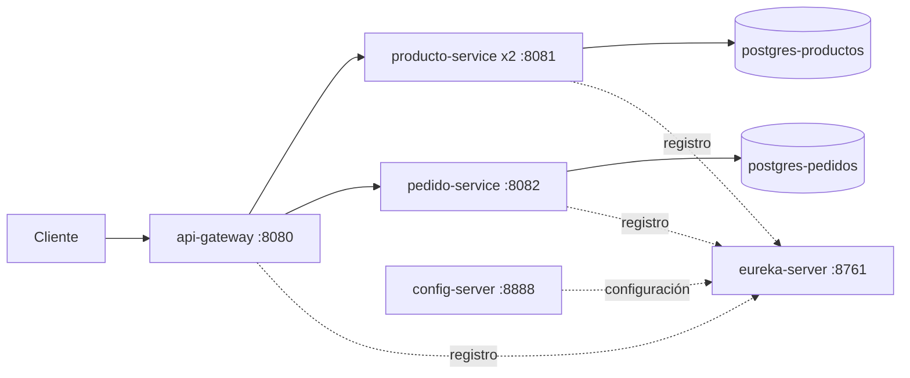
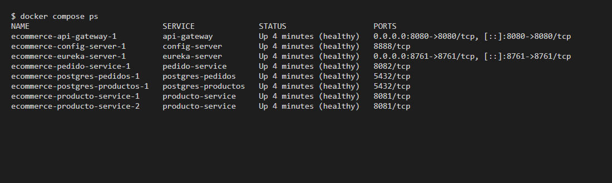
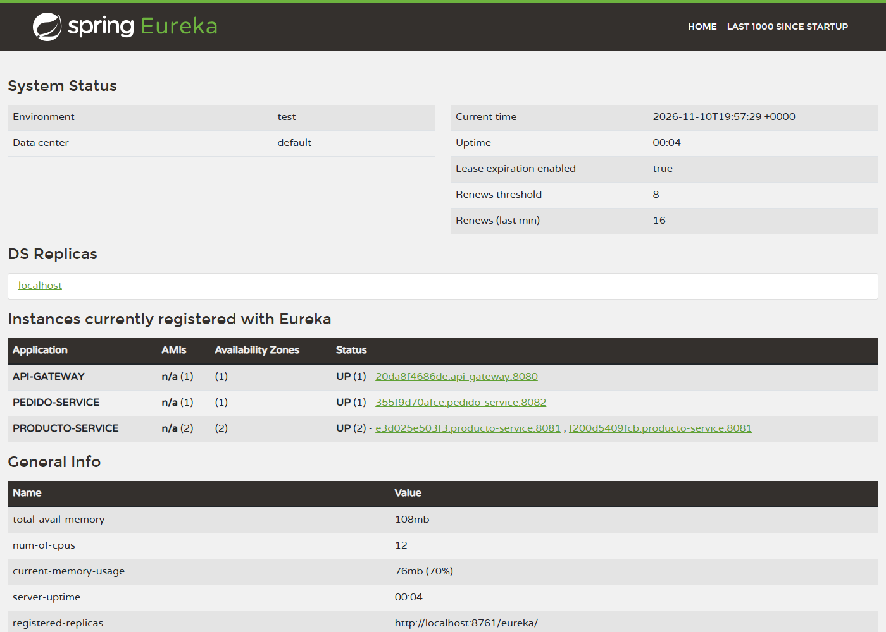
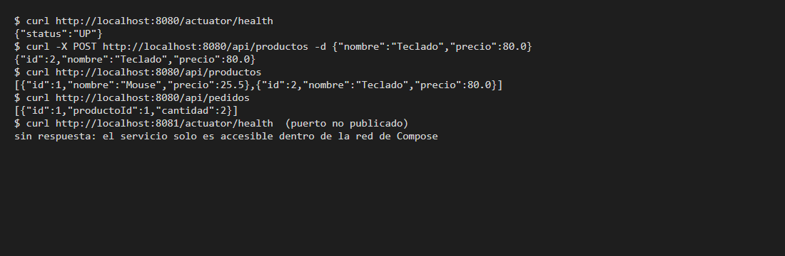

# ecommerce-microservicios

Microservicios Spring Boot (Config Server, Eureka, API Gateway, producto y pedido) con PostgreSQL, empaquetados en Docker y levantados con un solo comando: `docker compose up -d --build`.

Proyecto de la Electiva I (Semana 15 / Taller 4), desarrollado a partir de la *Guía de implementación: proyectos Spring Boot con Docker* ([docs/](docs/)).

## Integrantes

- Carlos Mario Bechara Arias
- Jose Daniel Zambrano Luna
- Rafael Eduardo Sarmiento Peña

## Arquitectura



Solo el **Gateway** (8080) y el panel de **Eureka** (8761) publican puertos al equipo; el resto queda dentro de la red de Compose.

| Servicio | Puerto interno | Publicado | Depende de |
|---|---|---|---|
| postgres-productos / postgres-pedidos | 5432 | No | – |
| config-server | 8888 | No | – |
| eureka-server | 8761 | Sí (panel) | config-server |
| producto-service (2 réplicas) | 8081 | No | eureka-server, postgres-productos |
| pedido-service | 8082 | No | eureka-server, postgres-pedidos |
| api-gateway | 8080 | Sí (entrada única) | eureka-server |

## Tecnologías

Java 21 · Spring Boot 3.5.16 · Spring Cloud 2025.0.3 (Config, Eureka, Gateway) · Spring Data JPA · PostgreSQL 16 · Docker y Docker Compose.

## Requisitos

- Docker Desktop o Docker Engine con Docker Compose v2.
- No hace falta instalar JDK ni Maven: la compilación ocurre dentro de Docker.
- 16 GB de RAM recomendados. En equipos de 8 GB, poner `replicas: 1` en `producto-service`.

## Despliegue

```bash
git clone https://github.com/CarlosBecharaDev2/Ecommerce-Microservicios.git
cd Ecommerce-Microservicios
cp .env.example .env
docker compose up -d --build
docker compose ps
```

Cuando los 8 contenedores muestren `healthy`, el sistema está listo (la primera construcción tarda unos minutos).

Credenciales: se definen en `.env` (no se versiona). `.env.example` trae los valores de ejemplo; cambia `DB_PASSWORD`.

## Uso

Todas las peticiones entran por el Gateway en `http://localhost:8080`.

| Método | URL | Descripción |
|---|---|---|
| GET | `/actuator/health` | Salud del Gateway |
| GET | `/api/productos` | Listar productos |
| GET | `/api/productos/{id}` | Obtener un producto |
| POST | `/api/productos` | Crear producto |
| GET | `/api/pedidos` | Listar pedidos |
| GET | `/api/pedidos/{id}` | Obtener un pedido |
| POST | `/api/pedidos` | Crear pedido |

```bash
curl -X POST http://localhost:8080/api/productos \
  -H "Content-Type: application/json" \
  -d '{"nombre":"Mouse","precio":25.5}'

curl -X POST http://localhost:8080/api/pedidos \
  -H "Content-Type: application/json" \
  -d '{"productoId":1,"cantidad":2}'
```

Colección Postman: [ecommerce.postman_collection.json](ecommerce.postman_collection.json). Panel de Eureka: <http://localhost:8761>.

## Evidencias

`docker compose ps` con todos los contenedores en `healthy`:



Panel de Eureka con las dos réplicas de `producto-service`:



Pruebas a través del Gateway:



## Estructura

```
.
├── docker-compose.yml
├── .env.example
├── config-server/      Dockerfile
├── eureka-server/      Dockerfile
├── api-gateway/        Dockerfile
├── producto-service/   Dockerfile
├── pedido-service/     Dockerfile
└── docs/               informe (.docx), guía (.pdf) y evidencias
```

Cada servicio tiene un Dockerfile multi-stage (`eclipse-temurin:21-jre-alpine`, usuario sin privilegios, capas del JAR), su `.dockerignore` y expone `/actuator/health` para el healthcheck de Compose.

## Comandos útiles

```bash
docker compose logs -f producto-service      # logs de un servicio
docker compose up -d --build producto-service # reconstruir uno solo
docker compose down                          # detener (conserva datos)
docker compose down -v                       # detener y borrar volúmenes
```
